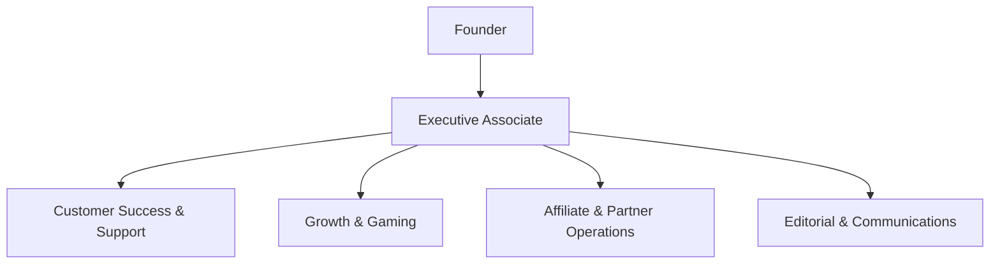

# JKTL team structure

Available at **Team → Team structure** (`/admin/team/structure`) and embedded on
the Owner's Team management page. The organogram displays roles and reporting
lines only. It neither selects nor displays assigned people's names.

| Function | Responsibility |
| --- | --- |
| Founder | Direction, financial decisions and final approvals |
| Executive Associate | Daily coordination, follow-up, reporting and escalation |
| Customer Success & Support | Onboarding, website setup, issues, renewals follow-up and retention |
| Growth & Gaming | Marketing, acquisition, games engagement and community |
| Affiliate & Partner Operations | Recruitment, onboarding, programme support and performance |
| Editorial & Communications | Articles, announcements, knowledge base and email content |

Daily, each function reports priorities, progress and blockers to the Executive
Associate. Weekly, the Executive Associate consolidates an update and decisions
needed from the Founder. Monthly, the Founder reviews performance and agrees
the next priorities.

Reporting lines do not assign account access. All recognized Team roles may view
the protected structure. The standalone chart route no longer reads the Team
member table. The Owner's separate Team account list retains real identities
and its existing editing and invitation controls.

The `executive_associate` role uses migration `078_executive_associate.sql` and
the existing permission matrix. Support, email composition and general insight
access do not grant company finance, ownership, payouts, team management or
other sensitive capabilities. No role, member, permission or invitation is
changed by the roles-only chart update.

This presentation update is held locally with the pending Business release.
Deployment remains paused while the hosting usage limit is unresolved.
