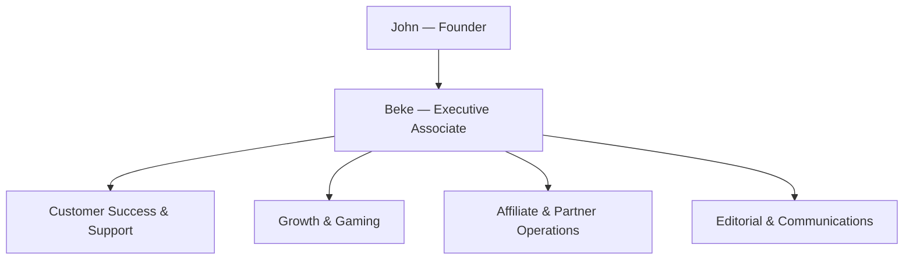

# JKTL team structure

Prepared 13 November 2026. Available in **Team → Team structure** (`/admin/team/structure`) and embedded on the Owner's Team management page.

| Function | Responsibility |
| --- | --- |
| John | Direction, financial decisions and final approvals |
| Beke | Daily coordination, follow-up, reporting and escalation |
| Customer Success & Support | Onboarding, website setup, issues, renewals follow-up and retention |
| Growth & Gaming | Marketing, acquisition, games engagement and community |
| Affiliate & Partner Operations | Recruitment, onboarding, programme support and performance |
| Editorial & Communications | Articles, announcements, knowledge base and email content |

Daily: each function reports priorities, progress and blockers to Beke. Weekly: Beke consolidates an update and decisions needed for John. Monthly: John reviews performance and agrees the next priorities.

## Account permissions

Reporting lines do not assign account access. All recognised team roles may view this protected structure. It selects only active team names and roles, never password hashes, emails, credential settings or financial records. Existing roles and assignments are preserved.

The new `executive_associate` role can use support and compose email, review the team structure and knowledge base, and has the existing general insight capabilities. Sensitive company-wide financial reports still require their separate permission; the associate cannot access them. Customer credentials, payouts, pricing, custom-project billing administration, domain operations, company finance, email branding and team-management actions remain denied, even if forged overrides are submitted. Support retains its existing assignment, consent and escalation rules. Existing email rules and delivery controls remain intact.

Beke's name in the chart is the founder's specified reporting structure, not a created account. Invite Beke through **Emails → Invite User → Executive Associate**, or change the correct existing account through the Owner's Team controls. No email was supplied, so no account has been assigned or invitation sent in this change.

## Rollout

Migration `078_executive_associate.sql` extends the role check and the existing audited record-correction function. The deployment prebuild includes it. Older replayed role-check migrations also accept the new value; subsequent deployments must not fail once an associate exists. No existing account is promoted or changed by the migration. Linked Business-user sign-in recognises the new role; invitation and editing dropdowns reuse `ROLE_LABEL`.

This change is local and not deployed. Do not run the migration against production before the approved deployment. Prior pending icon changes remain in the workspace.

## Validation

Production build, TypeScript and targeted ESLint passed. Permission/editorial/record-correction tests passed (23); support, consent, escalation and notification tests passed (11); growth-role regression passed. Email invitation/management checks passed, and navigation assertions now include the new structure link. PostgreSQL-compatible tests cover assigning/revoking the associate role through the existing audited editor and replaying constraints with an associate present. No production role assignment or migration was performed.

The rendered component was checked with production CSS at 390px and 1440px: four functions, John/Beke hierarchy, SVG icons and no horizontal overflow. Both actual production-server Team routes returned 307 to login when unauthenticated. Beke has no matching Team account in the connected database; an email address is required for an invitation.
